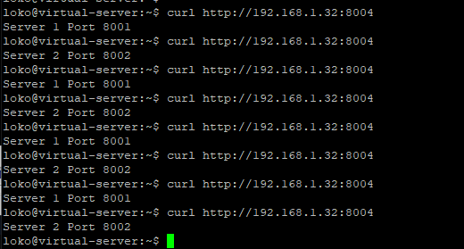
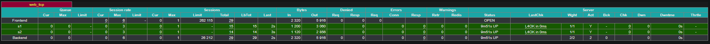
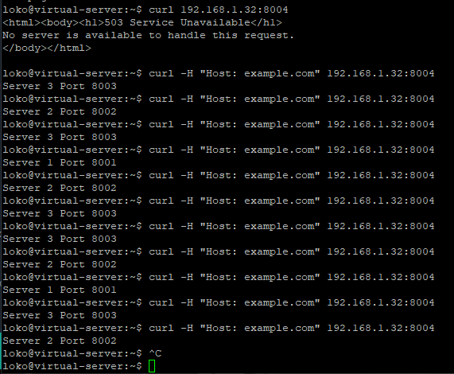
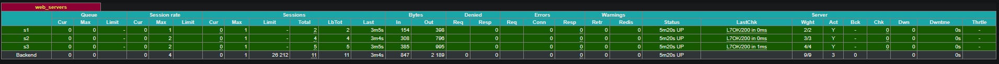

# [Задание](https://github.com/netology-code/sflt-homeworks/blob/main/2.md) к занятию "`Кластеризация и балансировка нагрузки`"

---

### Задание 1

`Установите и настройте HAProxy и настройте балансировку Round-robin на 4 уровне.`

Первый сервер был поставлен на `8001`, второй сервер `8002`, а HAProxy на `8004` для TCP

Файл конфигурации [haproxy.cfg](haproxy1/haproxy.cfg)

---

### Задание 2

`Настройте балансировку Weighted Round Robin на 7 уровне. HAproxy должен балансировать только тот http-трафик, который адресован домену example.local`

Первый сервер был поставлен на `8001`, второй сервер `8002`, третий сервер `8003`

Файл конфигурации [haproxy.cfg](haproxy2/haproxy.cfg)

---
